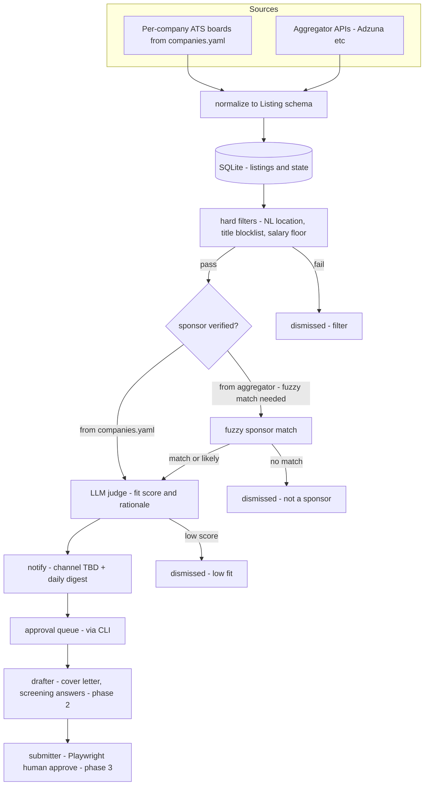

# recruitinator — architecture (v2)

Always-on, headless job monitor for a US citizen targeting the Dutch **Highly Skilled Migrant (HSM)** permit. Watches job listings as posted, cross-references the IND recognized-sponsor register, scores against the resume, and notifies. Runs unattended in Docker; approvals happen via CLI.

## The core insight: sponsor-first, inverted pipeline

Only **recognized sponsors** (the ~13k orgs in `netherlands-sponsors.csv`) can hire a non-EU worker via HSM without heavy friction, so:

1. **Curate target sponsors first** (`config/companies.yaml`) and poll *their* ATS boards via public JSON APIs. Sponsorship becomes a **property of the source**, not a per-listing lookup. No LinkedIn/Indeed scraping, no ToS risk, tiny request volume.
2. **Aggregators with real APIs** (Adzuna NL, Jooble, Remotive, HN Algolia) add breadth — including coverage of enterprises whose own ATS is hard to reach. These need per-listing fuzzy matching against the sponsor registry.
3. A **fuzzy matcher** over the registry serves the aggregator path and ad-hoc lookups.

## Collector landscape — who uses what, and how we organize it

**Live-probed during design:** Adyen → Greenhouse ✓ (jobs flowing), Mollie → Ashby ✓, GitLab → Greenhouse ✓, Backbase → SmartRecruiters endpoint ✓ (currently empty), Picnic/Sendcloud → not on the platforms guessed (404s). Lesson confirmed: **each company has exactly one primary ATS, you cannot assume which, and they occasionally switch** (stale tokens → 404 → alert).

| Platform | Typical users (NL sponsors) | Access | Priority |
|---|---|---|---|
| **Greenhouse** | Tech scale-ups: Adyen, GitLab-class | Public JSON GET | v1 |
| **Ashby** | Younger startups: Mollie | Public JSON GET | v1 |
| **SmartRecruiters** | Mid-market EU | Public JSON GET | v1 |
| **Lever** | Startups (declining share) | Public JSON GET | v1 |
| **Teamtailor** | EU/NL mid-market — big in NL | Public JSON GET | v1.1 |
| **Adzuna, Jooble, Remotive, HN** | Cross-ATS aggregation (catches Workday enterprises indirectly) | Official APIs | v1 |
| **Workday** | Large enterprises: Booking-class, ASML, ING | POST-JSON internal endpoint, no auth but fragile (tenant/site params) | phase 2 |

No single platform has "decent selection" alone — coverage = the union of per-company boards you track plus aggregators. Enterprise coverage comes cheaply via Adzuna (their postings get indexed) rather than fighting Workday in v1.

**Organization: the `boards` table is the single source of truth** (in SQLite; `companies.yaml` remains as a thin hand-editable override layer for aliases, priorities, and manual entries). Per company: `name`, `aliases[]`, `ats`, `board_token`, `status` (`verified | missing | stale`), `jobs_count`, `verified_at`.

### The board census — full-register mapping, up front

Before any collecting, run a **one-time census** that maps the *entire* ~13k sponsor register to their ATS boards. The CSV has no URLs (only names + KvK), so discovery works by **slug probing** rather than careers-page crawling:

1. Normalize every `Organisation` name (strip `B.V.`/`N.V.`/`Holding`/punctuation → slug: `Adyen B.V.` → `adyen`).
2. Probe each platform's public endpoint with the slug — `GET boards-api.greenhouse.io/v1/boards/{slug}/jobs`, `api.ashbyhq.com/posting-api/job-board/{slug}`, `api.lever.co/v0/postings/{slug}?mode=json`, `api.smartrecruiters.com/v1/companies/{slug}/postings`. A `200` with jobs = confirmed board; `404` = not that platform.
3. Misses get a second pass with slug variants (suffix-stripped, word-subsets, parent-company forms).
4. Results land in the `boards` table with `verified_at` + `jobs_count`; a report ranks companies by open NL-relevant roles.

Volume: ~13k × 4 platforms ≈ 52k requests, 404s return in ms. Run as `recruitinator census` — per-platform worker threads, jittered 0.3–0.7 s between requests (polite, unauthenticated public APIs), **checkpointed in SQLite after each batch so it's resumable**; expect an overnight one-time run. Re-run weekly (cheap — only re-probe `verified` + `missing` differently) to catch ATS switches, which surface as `verified → 404` transitions and alert via ntfy.

Complement later (phase 2): careers-URL fingerprinting (`recruitinator discover <url>`) and Workday tenant probing for the enterprises the slug census can't hit; aggregator coverage in v1 already catches many of those indirectly.

## System overview



Deterministic pipeline with LLM steps; every stage is a pure function with typed input/output, retries, and an audit trail.

## Process model — fully synchronous

The worker is a single **sync Python process** (no asyncio anywhere):

- `requests.Session` (with `HTTPAdapter`/`urllib3` Retry) for all HTTP; jittered sleep-based rate limiting per source.
- **APScheduler `BackgroundScheduler`** thread pool runs collector/matcher/digest jobs on jittered intervals; sync code is trivial to reason about headless.
- **Sync `OpenAI` client** for judge/drafter (base URL configurable — any OpenAI-compatible endpoint).
- ETag/`If-Modified-Since` caching per board; tenacity for retry/backoff around parse+persist.

## Data model (pydantic → SQLite, WAL)

### `Listing`

| field | notes |
|---|---|
| `job_key` | `sha256(source + ":" + source_id)` — dedupe PK |
| `source` / `source_id` | e.g. `greenhouse:adyen`, `adzuna:nl-12345` |
| `company_raw` / `company_norm` | normalized for matching |
| `title`, `location_raw`, `country`, `city` | extracted + standardized |
| `url_apply`, `url_view` | |
| `description_html` / `description_text` | text = stripped HTML |
| `salary_min/max/period` | when present (often null) |
| `published_at`, `first_seen_at`, `last_seen_at` | |
| `state` | state machine below |
| `raw_json` | full upstream payload for reprocessing |

### State machine

`NEW → FILTERED_OUT | SPONSOR_MATCHED → SCORED → NOTIFIED → APPROVED → DRAFTED → SUBMITTED → (CLOSED)` with user terminals `REJECTED_USER`, `DISMISSED`, `EXPIRED` (delisted upstream). Follow-up reminders at +7/+14 days after submission.

### `SponsorRecord`

From `netherlands-sponsors.csv` (~13k rows: `Organisation`, `KVK number` — note the messy quoting and `B.V.` suffixes). Stored with `name_norm` + trigram index. Match confidence tiers: `exact` / `high` / `review` — aggregator matches at `review` tier are flagged in the digest, never silently accepted. `recruitinator fetch-sponsors` re-imports the IND register monthly.

### `MatchResult` (LLM judge output, stored per listing)

`fit_score` (0–100), `rationale`, `strengths`, `gaps`, `salary_vs_threshold` (flag), `red_flags`. Fully auditable.

## Components

### 1. Collectors (`src/recruitinator/collectors/`)

`Collector` protocol → `list[Listing]`. `base.py` = shared `requests.Session`, rate limiting, ETag cache, retries. Modules: `greenhouse.py`, `ashby.py`, `smartrecruiters.py`, `lever.py` (v1); `teamtailor.py`, `workday.py` (phase 2); `adzuna.py` + more aggregators (v1 for breadth). Plus `discover.py` — the ATS fingerprinting helper that populates `companies.yaml`.

### 2. Sponsor registry (`sponsors.py`)

CSV → SQLite; `match(company_norm) -> (SponsorRecord | None, confidence)` via rapidfuzz.

### 3. Filters (pre-LLM, free)

Country = NL (or remote-EU, configurable); title blocklist; salary floor vs HSM thresholds — age-banded, indexed annually, **configurable constants with a verify-against-IND note** (most listings omit salary; advisory only).

### 4. Matcher (LLM judge)

Post-filter volume is small (tens/day) → no embedding prefilter in v1; judge directly with structured outputs. Resume parsed once to `data/resumes/resume.json`. sqlite-vec/pgvector only if aggregator volume justifies it later.

### 5. Notifier — ntfy.sh

Push via plain `requests.post("https://ntfy.sh/{topic}", ...)` — topic in `.env` (`NTFY_TOPIC`, optionally `NTFY_SERVER` for self-hosting). High-score jobs → one push each (title, company, score, click-through to posting); daily digest → one summary message; census/scheduler alerts (dead boards, errors) → ops topic. Approvals happen via CLI (`recruitinator review` — TUI over the queue), not push buttons.

### 6. Scheduler + CLI (`scheduler.py`, `cli.py`)

APScheduler jittered loops: collect 30m, digest daily, sponsor refresh monthly, expiry sweep hourly. Subcommands: `worker`, `collect`, `digest`, `discover`, `fetch-sponsors`, `review`, `match --job-key`, `backfill`.

### 7. Apply stages — phase 2/3, designed-for-not-built

Drafter (cover letter, screening answers incl. truthful work-authorization framing) after approval; Playwright submitter with persistent profile, receipts, CAPTCHA→human escalation, daily caps, company-level dedupe. Unattended auto-submit stays a flag, default **off**.

## Tech choices

| choice | rationale |
|---|---|
| **SQLite (WAL)** | confirmed sufficient; port to Postgres only if ever needed |
| **requests + urllib3 Retry + tenacity** | user preference; sync-everything architecture |
| **pydantic** | typed schemas end-to-end |
| **APScheduler BackgroundScheduler** | in-process jittered scheduling, thread pool |
| **rapidfuzz** | sponsor fuzzy matching |
| **OpenAI SDK (sync)** | judge + drafter; configurable base URL |
| YAML config | `companies.yaml` overrides — aliases, priorities, manual boards |
| **ntfy.sh** | zero-infra push; one HTTP POST; self-hostable later |

## Repo changes & layout

**Removed up front:** `src/chat.py`, `src/main.py`, `src/mcp_client.py` (headless — no chat). `mcp.json` stays on disk untouched for future use. README rewritten for the worker.

```
src/
  recruitinator/
    cli.py, config.py, db.py, models.py
    census/       slugify, probe, report        # full-register ATS mapping
    collectors/   base, greenhouse, ashby, smartrecruiters, lever, adzuna
    pipeline/     normalize, sponsors, matcher, notify_ntfy, scheduler
    apply/        # phase 2+: drafter, submitter
config/           companies.yaml (overrides only)
data/             recruitinator.db, resumes/
plans/            architecture.md
mcp.json          # kept, unused for now
```

## Risks & mitigations

- **ATS tokens go stale / companies switch ATS** → 404 alert in digest; `discover` re-runs; `companies.yaml` single fix point.
- **Fuzzy sponsor false positives** → confidence tiers; aggregator `review`-tier matches need human confirm.
- **LLM judge drift/cost** → structured outputs, stored rationale, filter-capped volume, model configurable.
- **Legal/ToS** → only official APIs; no LinkedIn/Indeed scraping; auto-submit off by default.
- **Silent death** → healthchecks.io ping per cycle; Sentry optional.

## Build phases

1. **Skeleton + cleanup**: remove chat CLI files, package layout, SQLite schema (incl. `boards` table) + migrations, models, config, CLI, deps (requests, pydantic, apscheduler, rapidfuzz, tenacity, pyyaml).
2. **Sponsor registry**: CSV import, name normalization — the census needs normalized names anyway.
3. **Board census**: slug normalizer, 4-platform prober with per-platform politeness + checkpoint/resume, `census` CLI, results report. Run it; the `boards` table becomes the collector target list.
4. **Collectors**: base + Greenhouse/Ashby/SmartRecruiters/Lever reading the `boards` table.
4. **Matcher**: resume schema, filters, LLM judge, audit storage.
5. **Notify**: ntfy push + digest + `review` CLI approvals.
6. **Scheduler + deployment**: worker loops, census re-probe weekly, Dockerfile, compose, healthcheck ping.
7. **Phase 2+**: drafter, careers-URL discovery, Teamtailor/Workday, Playwright submitter.

## Decision defaults (confirmed/updated)

SQLite ✓. requests/sync ✓. Chat CLI removed ✓. No embeddings v1 ✓. Dutch-only geography v1 (EU-remote allowed) ✓. Auto-submit off ✓. **ntfy.sh for push** ✓. **Full-register board census runs before collecting** ✓.
